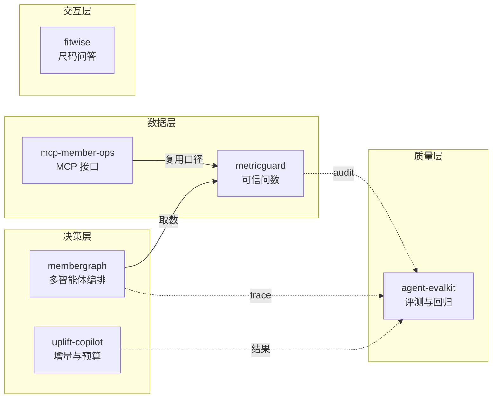

# Agent Portfolio · 会员增长智能体工程

六个可独立部署、可离线运行、可被 CI 门禁的 Agent 工程。领域取自服装/内衣会员运营，数据全部为合成数据。

> 这批项目要证明的不是「会用框架调 API」，而是三件事：
> **结论可追溯、口径可治理、质量可证明。**

---

## 仓库

| 仓库 | 一句话 | 核心技术 | 实测 |
|---|---|---|---|
| [**membergraph**](https://github.com/Lilim-ing/membergraph) | 会员增长多智能体工作台 | 版本化黑板 / 证据账本 / Critic 回路 / 预算降级 / trace 回放 | 44 tests · eval 6/6 |
| [**metricguard**](https://github.com/Lilim-ing/metricguard) | 指标口径守卫与可信问数网关 | 语义层 YAML / sqlglot AST 策略 / 口径弱核对 / PII 拦截 / 审计 | 40 tests · eval 40/40 |
| [**agent-evalkit**](https://github.com/Lilim-ing/agent-evalkit) | Agent 评测与回归工具包 | trace-first 断言 / bootstrap CI / flaky 检测 / judge κ 校准 | 18 tests · 负向对照 3/3 |
| [**uplift-copilot**](https://github.com/Lilim-ing/uplift-copilot) | 增量建模与预算分配 | T-learner / transformed outcome / Qini / 预算约束选人 | 15 tests · **差异不显著** |
| [**fitwise**](https://github.com/Lilim-ing/fitwise) | 内衣尺码与穿着知识助手 | 确定性尺码算术 / 引用式检索 / 默认拒答 | 22 tests |
| [**mcp-member-ops**](https://github.com/Lilim-ing/mcp-member-ops) | 会员运营 MCP 服务 | 手写 JSON-RPC / 能力级 RBAC / 返回层脱敏 / 审计 | 18 tests |



---

## 快速导航

| 你想看什么 | 去哪个仓库 |
|---|---|
| 多 Agent 怎么不写成串行 chain | [membergraph](https://github.com/Lilim-ing/membergraph) |
| 企业为什么不敢开放问数，怎么管住口径/PII/审计 | [metricguard](https://github.com/Lilim-ing/metricguard) |
| 怎么证明一个 Agent 没变差 | [agent-evalkit](https://github.com/Lilim-ing/agent-evalkit) |
| 什么时候不该用模型：增量、预算、实验设计 | [uplift-copilot](https://github.com/Lilim-ing/uplift-copilot) |
| 领域知识里哪些该用代码、哪些该拒答 | [fitwise](https://github.com/Lilim-ing/fitwise) |
| 把数据能力按 MCP 暴露给 AI 客户端 | [mcp-member-ops](https://github.com/Lilim-ing/mcp-member-ops) |

---

## 六个项目，三条主线

**编排（membergraph）** —— 多 Agent 怎么不写成串行 chain：黑板版本化、证据账本、Critic 真打回、预算耗尽诚实降级。

**治理（metricguard / mcp-member-ops）** —— 为什么企业不敢开放数据：口径不可信、PII 控不住、越权查不到。前者管 SQL，后者管接口。

**判断（uplift-copilot / fitwise）** —— 什么时候不该用模型。uplift 里模型与基线在 500 人规模下无法区分；fitwise 里尺码根本不该交给模型算。**知道边界在哪，比多用一次模型更难。**

**证明（agent-evalkit）** —— 断言对象是 trace 而不是最终文本；不稳定用例单独标记；judge 不校准就不许进门禁。

---

## 实测（全量验收）

| 仓库 | 测试 | 合规 | 评测 | GitHub Actions |
|---|---|---|---|---|
| membergraph | 44 passed | PASS | 6/6 | success |
| metricguard | 40 passed | PASS | 40/40（对抗 10/10，误拒 0） | success |
| agent-evalkit | 18 passed | PASS | 主套件 100%；负向对照 3/3 | success |
| uplift-copilot | 15 passed | PASS | — | success |
| fitwise | 22 passed | PASS | — | success |
| mcp-member-ops | 18 passed | PASS | — | success |
| **合计** | **157 passed** | **6/6 PASS** | — | **6/6 success** |

所有数字来自本地全量验收与各仓库 GitHub Actions 运行。

### 两个值得单说的结论

**uplift-copilot 的负面结论**：默认逻辑回归下 Qini 为 -0.0001、实测 2.32%；梯度提升版 Qini 0.0473、实测 4.28%。但 500 人规模下所有策略的 95% 置信区间都跨 0，**无法判定谁更好**。每组检测 3 个点的增量需要 1,356 人。**结论：先扩样本，再谈模型。**

**fitwise 的确定性**：尺码是算术，不交给模型。姐妹尺码最初写反了（底围减小却降杯），测试抓住——这种错误在页面上毫无破绽。

---

## 快速开始

每个仓库都是三步，任选一个：

```bash
git clone https://github.com/Lilim-ing/membergraph.git
cd membergraph
pip install -e ".[dev]"
python -m pytest
```

其余五个仓库同理，把仓库名换掉即可。

离线 demo：

```bash
cd membergraph && membergraph run "9月复购率环比下滑，给出一个30天挽回方案" --provider fake -o runs/demo
cd metricguard && metricguard ask "9月复购率按渠道"
cd agent-evalkit && evalkit run evals/cases.yaml -o reports/baseline
cd uplift-copilot && uplift run --model t_learner --budget 4000
cd fitwise && fitwise size --underbust 78 --bust 90.5
cd mcp-member-ops && MCPOPS_ROLE=analyst mcpops serve
```

> Windows PowerShell 下，`MCPOPS_ROLE=analyst mcpops serve` 需要写成：
> `$env:MCPOPS_ROLE="analyst"; mcpops serve`

**全部不需要 API key**，实际花费 0 元。报告里的成本数字均为模拟值，已在各仓库显式标注。

---

## 领域与数据

统一数据模型：会员 / 商品 / 订单 / 明细 / 行为 / 活动。

| 表 | 行数 |
|---|---|
| members | 8,000 |
| orders | 23,697 |
| order_items | 37,251 |
| behaviors | 34,949 |
| campaign_assignments | 9,600 |

- 固定种子 `20261021`；会员/订单相关仓库内附已生成的 fixtures（`data/fixtures/*.parquet`），fitwise 使用独立知识库，agent-evalkit 使用内置 toy agent
- 分布参数为公开行业量级假设 + 人为设定，见相关仓库的 `docs/DATA_ASSUMPTIONS.md`
- 商品为虚构系列，不对应任何真实货号

---

## 合规声明

**不含任何企业的真实数据、真实会员信息、真实商品目录、真实口径文档。**

- 零公司名、零真实品牌、零数据库连接串
- 手机号 / 证件号由生成器伪造，仅用于演示 PII 拦截
- 每个仓库 `make compliance` 可扫描验证（关键词 + PII 正则 + 连接串模式）
- 分布参数也不来自任何企业报表，`DATA_ASSUMPTIONS.md` 逐项标注来源性质

---

## 作者与许可

会员数据分析 / 增长分析方向的作品集项目。各仓库独立采用 MIT License。

本页只做索引；每个项目的运行方式、评测报告和设计取舍都在各自仓库的 README 中。
