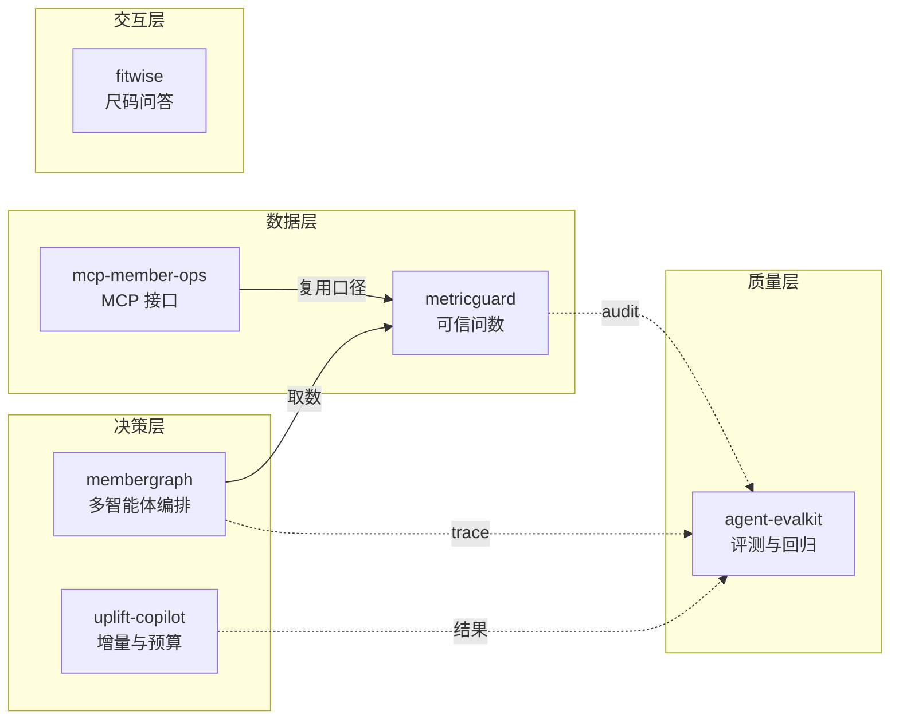

# Agent Portfolio · 会员增长智能体工程

六个独立的 Agent 项目，领域取自服装 / 内衣会员运营，数据全部是合成的。每个仓库都能离线跑，也都在 GitHub Actions 上跑测试和合规检查。

## 仓库

| 仓库 | 做什么 | 主要实现 | 测试 |
|---|---|---|---|
| [membergraph](https://github.com/Lilim-ing/membergraph) | 会员增长多智能体工作台 | 版本化黑板 / 证据账本 / Critic 打回 / 预算降级 / trace 回放 | 44 tests · eval 6/6 |
| [metricguard](https://github.com/Lilim-ing/metricguard) | 指标口径校验和问数网关 | 语义层 YAML / sqlglot AST 策略 / 口径弱核对 / PII 拦截 / 审计 | 40 tests · eval 40/40 |
| [agent-evalkit](https://github.com/Lilim-ing/agent-evalkit) | Agent 评测与回归工具包 | trace 断言 / bootstrap 置信区间 / flaky 检测 / judge κ 校准 | 18 tests · 负向对照 3/3 |
| [uplift-copilot](https://github.com/Lilim-ing/uplift-copilot) | 增量建模和预算分配 | T-learner / transformed outcome / Qini / 预算约束选人 | 15 tests · 差异不显著 |
| [fitwise](https://github.com/Lilim-ing/fitwise) | 内衣尺码和穿着知识助手 | 确定性尺码计算 / 引用式检索 / 默认拒答 | 22 tests |
| [mcp-member-ops](https://github.com/Lilim-ing/mcp-member-ops) | 会员运营 MCP 服务 | 手写 JSON-RPC / 能力级 RBAC / 返回字段脱敏 / 审计 | 18 tests |



## 按问题找项目

| 想了解什么 | 去哪个仓库 |
|---|---|
| 多 Agent 怎么避免写成一条串行链 | [membergraph](https://github.com/Lilim-ing/membergraph) |
| 开放问数时怎么管口径、PII 和审计 | [metricguard](https://github.com/Lilim-ing/metricguard) |
| 怎么判断一个 Agent 是不是变差了 | [agent-evalkit](https://github.com/Lilim-ing/agent-evalkit) |
| 增量、预算和实验样本量怎么算 | [uplift-copilot](https://github.com/Lilim-ing/uplift-copilot) |
| 领域知识里哪些交给代码、哪些直接拒答 | [fitwise](https://github.com/Lilim-ing/fitwise) |
| 把数据能力按 MCP 暴露给 AI 客户端 | [mcp-member-ops](https://github.com/Lilim-ing/mcp-member-ops) |

## 项目之间的关系

membergraph 负责编排，取数走 metricguard；mcp-member-ops 也复用 metricguard 的指标口径。agent-evalkit 接收各项目的 trace 做评测，可以放进 CI。uplift-copilot 和 fitwise 各自独立：前者做增量和预算，后者做尺码问答。

## 实测（全量验收）

| 仓库 | 测试 | 合规 | 评测 | GitHub Actions |
|---|---|---|---|---|
| membergraph | 44 passed | PASS | 6/6 | success |
| metricguard | 40 passed | PASS | 40/40（对抗 10/10，误拒 0） | success |
| agent-evalkit | 18 passed | PASS | 主套件 100%；负向对照 3/3 | success |
| uplift-copilot | 15 passed | PASS | — | success |
| fitwise | 22 passed | PASS | — | success |
| mcp-member-ops | 18 passed | PASS | — | success |
| 合计 | 157 passed | 6/6 PASS | — | 6/6 success |

数字来自本地全量验收和各仓库的 GitHub Actions 运行。

## 快速开始

每个仓库都是三步：

```bash
git clone https://github.com/Lilim-ing/membergraph.git
cd membergraph
pip install -e ".[dev]"
python -m pytest
```

其余五个仓库把仓库名换掉即可。

离线 demo：

```bash
cd membergraph && membergraph run "9月复购率环比下滑，给出一个30天挽回方案" --provider fake -o runs/demo
cd metricguard && metricguard ask "9月复购率按渠道"
cd agent-evalkit && evalkit run evals/cases.yaml -o reports/baseline
cd uplift-copilot && uplift run --model t_learner --budget 4000
cd fitwise && fitwise size --underbust 78 --bust 90.5
cd mcp-member-ops && MCPOPS_ROLE=analyst mcpops serve
```

Windows PowerShell 下，最后一行要写成 `$env:MCPOPS_ROLE="analyst"; mcpops serve`。

这些 demo 都不需要 API key，实际花费 0 元。报告里的成本数字是模拟值，各仓库里都有说明。

## 领域与数据

统一数据模型：会员 / 商品 / 订单 / 明细 / 行为 / 活动。

| 表 | 行数 |
|---|---|
| members | 8,000 |
| orders | 23,697 |
| order_items | 37,251 |
| behaviors | 34,949 |
| campaign_assignments | 9,600 |

- 固定种子 `20261021`。会员和订单相关的仓库内附已生成的 fixtures（`data/fixtures/*.parquet`）；fitwise 用独立知识库，agent-evalkit 用内置 toy agent
- 分布参数是公开行业量级假设加人为设定，见相关仓库的 `docs/DATA_ASSUMPTIONS.md`
- 商品为虚构系列，不对应任何真实货号

## 合规

仓库里没有企业的真实数据、真实会员信息、真实商品目录或真实口径文档。

- 没有公司名、真实品牌、数据库连接串
- 手机号和证件号由生成器伪造，只用于演示 PII 拦截
- 每个仓库可以跑 `make compliance`，检查关键词、PII 正则和连接串模式
- 分布参数也不来自任何企业报表，`DATA_ASSUMPTIONS.md` 里逐项标注了来源性质

## 作者与许可

会员数据分析 / 增长分析方向的作品集。各仓库独立采用 MIT License。

这个页面只做索引。每个项目的运行方式、评测报告和设计取舍在各自仓库的 README 里。
